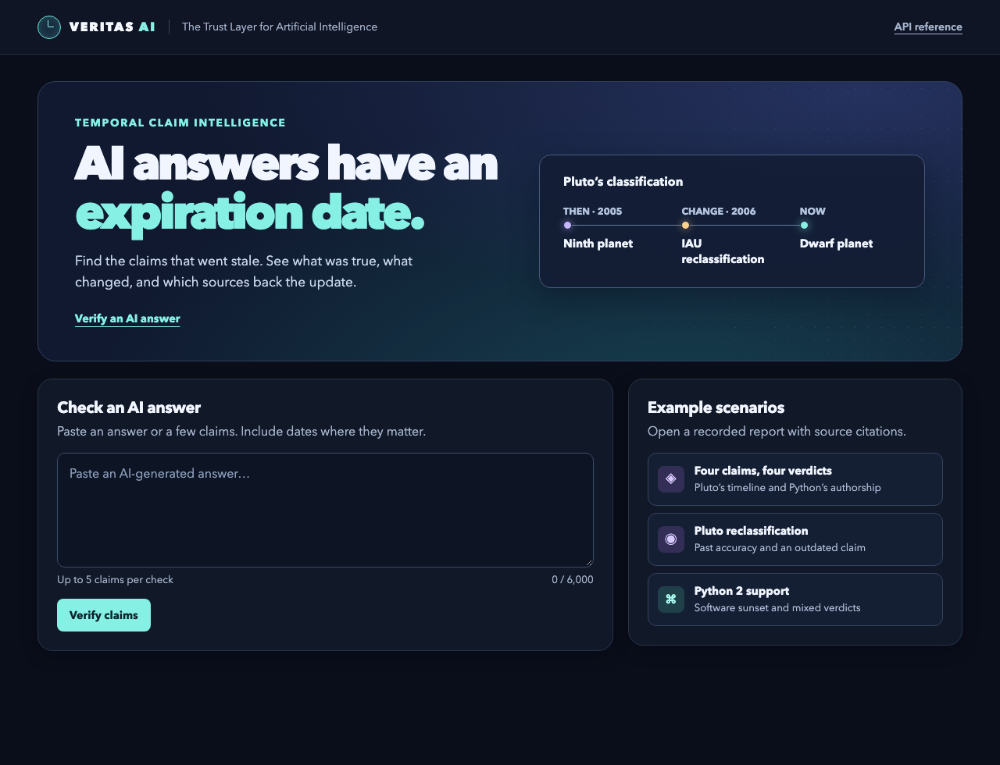
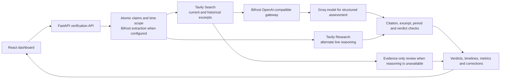

# VERITAS AI

**The Trust Layer for Artificial Intelligence**

VERITAS AI detects stale claims in AI-generated answers. An AI answer can repeat a fact that once held as though it still applies. Temporal Claim Intelligence identifies the period a claim describes, checks evidence for that period, and shows the change when a previously correct claim has been superseded.

Paste an answer to get claim-level verdicts, dated citations, evidence-backed corrections, and an exportable verification report. The **Then → Change → Now** timeline makes the difference between outdated wording and accurate history visible. The dashboard keeps the last completed report available during a follow-up request or provider error.

## Screenshots




## Run locally

Requirements are Python 3.11 or later and Node.js 22.12 or later. The app was tested with Python 3.14. From the project root, install dependencies and build the React dashboard.

```sh
python3 -m venv backend/.venv
backend/.venv/bin/python -m pip install -r backend/requirements.txt
npm --prefix frontend ci
npm --prefix frontend run build
```

Use the existing virtual environment if it is already set up. Set `TAVILY_API_KEY` in the process environment or in `backend/.env` for live checks. Then start FastAPI.

```sh
backend/.venv/bin/python -m uvicorn backend.main:app --reload
```

Open [VERITAS AI](http://127.0.0.1:8000/app/) or the [interactive API reference](http://127.0.0.1:8000/docs). The recorded examples run locally. If port 8000 already serves VERITAS AI, use the existing dashboard. To run a second instance, pass `--port 8001` and open `http://127.0.0.1:8001/app/`.

For React development, keep FastAPI on port 8000 and start Vite in a second terminal.

```sh
npm --prefix frontend run dev
```

Open the [Vite development dashboard](http://127.0.0.1:5173/app/).

## Architecture



The stack is FastAPI, Pydantic, HTTPX, React, Vite, Tavily Search and Research, and an optional Bifrost gateway routing to Groq. The browser calls FastAPI. FastAPI sends selected claims to Tavily and, when configured, sends source excerpts and claim data to Bifrost. API credentials are read server-side.

| Pipeline shown in the report | How the result is produced |
| --- | --- |
| Tavily Search + Bifrost | The gateway extracts atomic claims and assesses retrieved excerpts. The backend checks structured output, claim-specific source IDs, quoted text, and dates before assigning verdicts. |
| Tavily Research | Research supplies temporal assessments and citations. The backend checks source and period coverage and assigns a verdict from the evidence roles. |
| Tavily Search · evidence only | Search supplies excerpts when reasoning is unavailable. Claims receive **Needs review** and freshness is unavailable. |
| Recorded example | Source-backed demonstration data exercises the report interface locally. |

### Server configuration

The [environment template](backend/.env.example) lists the supported settings.

| Variable | Purpose |
| --- | --- |
| `TAVILY_API_KEY` | Tavily key for live retrieval and research. |
| `TAVILY_RESEARCH_ENABLED` | Defaults to `true`. Set to `false` to exercise the Bifrost or Search-only path. |
| `BIFROST_BASE_URL` | Enables gateway integration. For local Bifrost use `http://127.0.0.1:8080/openai/v1`. FastAPI sends `POST /chat/completions` under this base URL. |
| `BIFROST_VIRTUAL_KEY` | Optional gateway virtual key sent as `x-bf-vk`. A configured key also enables the default local URL. |
| `BIFROST_AUTH_TOKEN` | Separate bearer token when the gateway requires HTTP authentication. |
| `BIFROST_MODEL` | Defaults to `groq/openai/gpt-oss-120b`. Set this to a model allowed by your gateway. |

Configure the Groq provider and model in Bifrost, then use a virtual key that grants access to it. A report showing **Tavily Search + Bifrost** with a Groq model confirms that inference returned a structured, excerpt-grounded result. The report discloses fallback on authentication, timeout, or malformed output. The default model follows Groq’s migration guidance for the preferred Llama model. [Groq deprecation guidance](https://console.groq.com/docs/deprecations) [Bifrost virtual-key reference](https://github.com/maximhq/bifrost/blob/dev/docs/features/governance/virtual-keys.mdx)

Use `BIFROST_VIRTUAL_KEY` for inference governance. The gateway can also require a separate authentication credential. Its setup token serves the management onboarding flow. The local container answered its health endpoint, and its management API returned HTTP 401. The app currently has only a Tavily credential configured. Authorization handling is covered by tests with simulated responses. [Bifrost authentication documentation](https://github.com/maximhq/bifrost/blob/dev/docs/features/governance/virtual-keys.mdx)

### Read the report

| Verdict | Evidence required |
| --- | --- |
| Supported today | Sources support the current state or a stable fact. |
| Historically correct | Sources support the claim during its stated past period. |
| Outdated | Sources establish the earlier state and contradict the same proposition today. |
| Contradicted | Sources refute the claim during its relevant period. Prior validity has not been established. |
| Needs review | Scope, evidence coverage, corroboration, or source agreement is insufficient. |

The dated transition requires evidence of a specific change. Effective periods describe when the cited fact applied. Publication dates appear separately when the provider supplies them. A verdict requires a recognized publisher or corroboration from separate publishers. Publisher categories are a heuristic, and readers can inspect the actual citations.

Evidence also has to match the claim’s entity and qualifiers. A team’s win can disprove an organization-wide claim of zero wins. That team's earlier record by itself describes only the team. Evidence outside the claim’s scope is available as context. The API returns `subject_quantifier` for the claim and `subject_relation` for each citation. A bounded Tavily follow-up can clarify missing historical or current evidence while preserving an established verdict.

**Answer freshness** is the percentage of assessable present-day claims that still hold, calculated as `supported current / (supported current + outdated)`. The report shows which claims were counted and any present-day claims excluded from the score. **Evidence coverage** is the share of checked claims that reached a cited verdict. Both are descriptive metrics. Claim-level freshness is 100 for supported present-day claims, 0 for outdated claims, and unavailable for the other results.

### API

| Endpoint | Result |
| --- | --- |
| `POST /verify` | Accepts `{"answer":"Pluto is the ninth planet."}` and returns a structured report. |
| `GET /demo?scenario=mixed` | Recorded four-claim showcase with a dated transition, correction, and four distinct verdicts. |
| `GET /demo?scenario=pluto` | Recorded Pluto report. This is the default example. |
| `GET /demo?scenario=python` | Recorded Python 2 support report. |
| `GET /health` | Verifies that the FastAPI process is running. |
| `GET /docs` | Interactive OpenAPI documentation for requests and response schemas. |

Requests accept up to 6,000 characters. The report checks the first five distinct candidate claims and counts omitted candidates. FastAPI limits concurrent verifications per process and reports unavailable providers through bounded requests and readable errors.

## 60–90-second demo

Open **Four claims, four verdicts** for the recorded walkthrough. It pairs Pluto’s present-day and 2005 classifications with one supported and one contradicted claim about Python’s creation. Walk through **Then**, **Change**, and **Now**, show the IAU citation, and copy the correction. Start a separate live check before the talk if you want to show the active provider. [Timed script and pitch outline](docs/pitch.md)

## Tests and limitations

```sh
backend/.venv/bin/python -m unittest discover -s backend/tests -v
npm --prefix frontend run build
```

Tests cover all five verdicts, compound extraction, exact dates, organization versus team scope, evidence conflicts, unsupported corrections, gateway response validation, API failures, OpenAPI, and demo metrics. [Engineering audit](docs/engineering-audit.md)

| Local integration check | Result |
| --- | --- |
| Tavily Search | Returned live excerpts through the evidence-only fallback. |
| Tavily Research | Returned all five expected verdicts in the React dashboard and passed the live franchise-versus-team scope check. |
| Bifrost → Groq | Local gateway health returned 200 and the protected management endpoint returned 401. Earlier inference returned 401. The app needs an authorized inference credential for a live Groq check. |

- Live reasoning depends on provider access, source quality, and latency. Search-only reports preserve evidence for manual review.
- Without configured Bifrost access, extraction uses English sentence and clause rules. Complex clauses and temporal expressions can require manual review. Subject relationships are proposed by the reasoning provider and checked against the claim’s quantifier, so ambiguous entity names still need care.
- Source quality categories are heuristic. A single research provider’s assessment still warrants checking the linked sources.
- Live Bifrost inference requires an authorized gateway and working Groq provider configuration.

## Roadmap

Priorities are a larger claim-and-evidence evaluation set, stronger temporal interval handling, and a verified gateway deployment. Date-selectable verification and whole-answer repair are follow-on features once historical coverage and correction grounding can be evaluated reliably.
